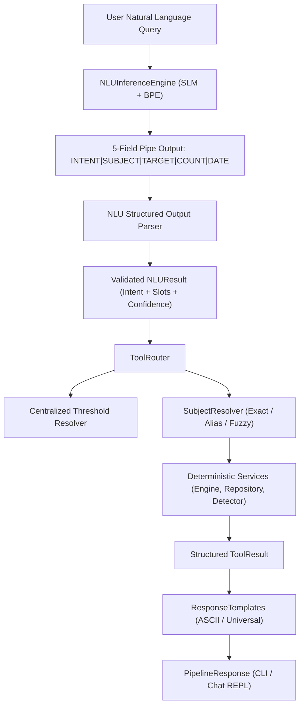

# Phase 8 — NLU Inference, Parser, Tool Router & Response Pipeline

## 1. Overview & Architecture

Phase 8 implements the complete runtime application and inference stack connecting the frozen custom Small Language Model (SLM) to the deterministic business logic and SQLite persistence layers.

### Architectural Principles
- **Strict Boundary Separation**: The SLM is strictly restricted to NLU intent and slot extraction. It performs zero arithmetic, date calculations, or database modifications.
- **Deterministic Tool Execution**: All calculations (attendance percentages, bunk margins, target projections, and change detections) are performed by Python deterministic engines (`attendance.engine`, `attendance.change_detector`, `attendance.repository`).
- **Frozen SLM Checkpoint**: Operates against the frozen Phase 7.6 boundary checkpoint (`checkpoints/phase7_6_boundary/best.pt`), with 5,853,184 parameters and 80.63% intent accuracy.

---

## 2. Implemented Components

### 2.1 Structured Output Parser (`attendance_tracker/slm/inference/parser.py`)
- Parses the 5-field format: `INTENT|SUBJECT|TARGET|COUNT|DATE`.
- Validates the 8 canonical intents:
  - `GET_ATTENDANCE`
  - `GET_SUBJECT_ATTENDANCE`
  - `ATTENDANCE_PROJECTION`
  - `CLASSES_REQUIRED_FOR_TARGET`
  - `MAX_CLASSES_CAN_MISS`
  - `CHECK_ATTENDANCE_UPDATE`
  - `HELP`
  - `UNKNOWN`
- Normalizes `"NONE"` and empty strings to `None`.
- Safely casts targets to `float` and counts to `int`.
- Gracefully handles malformed outputs without raising uncaught exceptions.

### 2.2 NLU Inference Engine (`attendance_tracker/slm/inference/nlu.py`)
- Loads `AttendanceSLM` and scratch `BPETokenizer` (4,096 vocabulary).
- Encodes queries as `[BOS] + query_tokens + [SEP]` where `SEP = 1098` (`<unused_0>`).
- Performs autoregressive greedy decoding stopping at `[EOS]` (ID 3) or context limit (256).
- Computes exact intent confidence and top-k intent probability distribution from the first generated token logits.
- Supports single-query (`predict`) and batch (`predict_batch`) inference with sub-100ms typical latency on GPU/CPU.

### 2.3 Subject Resolver (`attendance_tracker/core/subject_resolver.py`)
- Resolves all 9 canonical subjects and 36 authoritative aliases:
  1. Exact canonical subject code match (e.g. `22PC1IT202`)
  2. Exact short name match (e.g. `OS`, `IoTAP`, `DE LAB`)
  3. Exact full name match (e.g. `Operating Systems`)
  4. Authoritative alias match (e.g. `operating systems`, `iot lab`, `data eng`, `gender`)
  5. Keyword / word subset match
  6. High-confidence fuzzy string matching (cutoff $\ge 0.60$) for typo tolerance.

### 2.4 Centralized Threshold Resolver (`attendance_tracker/core/thresholds.py`)
- **College Threshold**: 75.0% (`config.attendance.college_threshold`)
- **Personal Target**: 70.0% (`config.attendance.personal_target`)
- **Resolution Rules**:
  1. *Explicit Percentage*: Any explicit percentage in the user query (e.g., `80%`, `at 70%`, `reach 85%`) takes highest precedence.
  2. *Personal Target Language*: Phrases such as `"my target"`, `"my goal"`, `"stay above my target"`, `"personal target"` resolve to **70.0%**.
  3. *College Requirement Language*: Phrases such as `"college requirement"`, `"college threshold"`, `"minimum attendance"`, `"required percentage"` resolve to **75.0%**.
  4. *Operation Default (No Target Specified)*:
     - `MAX_CLASSES_CAN_MISS`: Defaults strictly to **75.0%** (college threshold).
     - `CLASSES_REQUIRED_FOR_TARGET`: Defaults to **75.0%** (college threshold / subject threshold).
     - The application layer filters out unprompted SLM default artifacts when no explicit number or target language was stated by the user.

### 2.5 Tool Router (`attendance_tracker/core/tool_router.py`)
- Dispatches parsed NLU results to deterministic services:
  - `route_get_attendance()`: Queries overall attendance across all subjects from SQLite.
  - `route_get_subject_attendance()`: Resolves subject and queries individual subject records.
  - `route_projection()`: Computes projection for attending or missing $N$ classes.
  - `route_classes_required()`: Calculates consecutive classes required to reach a target percentage.
  - `route_max_can_miss()`: Computes safe bunk margin before breaching threshold.
  - `route_check_attendance_update()`: Evaluates latest snapshot changes against timetable/calendar.
  - `route_help()`: Returns capabilities and canonical subject directory.
  - `route_unknown()`: Returns fallback explanation and suggested query templates.
- Provides end-to-end `process(query: str) -> PipelineResponse`.

### 2.6 Response Templates (`attendance_tracker/response/templates.py`)
- Formats structured tool results into clean, readable, ASCII-safe text.
- Provides distinct formatting for goals, projections, bunk margins, and change reports.
- Avoids fragile non-ASCII character encodings on Windows cp1252 consoles.

### 2.7 Command-Line Interface (`attendance_tracker/cli/main.py`)
- `python -m attendance_tracker.cli overview`: Displays the Rich attendance summary table.
- `python -m attendance_tracker.cli ask "<query>"`: Processes a single natural language question with intent/slot metadata and rendered response.
- `python -m attendance_tracker.cli chat`: Starts an interactive REPL session with live NLU diagnostics and graceful exit commands (`exit`, `quit`, `q`).

---

## 3. Verified Execution Across 8 Representative Queries

| # | Query | Extracted Intent | Slots | Confidence | Latency | Result |
|---|---|---|---|---|---|---|
| 1 | *What is my overall attendance percentage?* | `GET_ATTENDANCE` | - | 100.00% | 614.1ms | 50.42% (119/236) |
| 2 | *How many classes have I attended in OS?* | `GET_SUBJECT_ATTENDANCE` | `subject=OS` | 99.94% | 48.3ms | 60.71% (17/28) |
| 3 | *What happens if I attend next 3 classes of IoT?* | `ATTENDANCE_PROJECTION` | `subject=IoTAP, count=3` | 99.97% | 53.4ms | 18/30 (60.00%) |
| 4 | *How many classes do I need to attend to reach 75% in DE?* | `CLASSES_REQUIRED_FOR_TARGET` | `subject=DE, target=75.0` | 100.00% | 49.6ms | 40 classes |
| 5 | *How many classes can I miss in ACD?* | `MAX_CLASSES_CAN_MISS` | `subject=ACD, threshold=75.0` | 100.00% | 752.2ms | 0 classes (below 75% threshold) |
| 6 | *Has my attendance been updated today?* | `CHECK_ATTENDANCE_UPDATE` | `date=TODAY` | 100.00% | 136.5ms | Up to date (snapshot #1) |
| 7 | *What can you do?* | `HELP` | - | 100.00% | 125.3ms | Capabilities & Subjects |
| 8 | *Tell me a joke* | `UNKNOWN` | - | 100.00% | 115.0ms | Clarification & Examples |

---

## 4. Authoritative Threshold Verification Matrix

| Query | Expected Target | Resolved Target | Status |
|---|---:|---:|:---:|
| *How many classes can I miss in ACD?* | 75.0% | 75.0% | **PASS** |
| *How many ACD classes can I miss?* | 75.0% | 75.0% | **PASS** |
| *How many ACD classes can I miss at 70%?* | 70.0% | 70.0% | **PASS** |
| *How many ACD classes can I miss at 80%?* | 80.0% | 80.0% | **PASS** |
| *How many ACD classes can I miss at my target?* | 70.0% | 70.0% | **PASS** |
| *How many ACD classes can I miss for the college requirement?* | 75.0% | 75.0% | **PASS** |
| *How many ACD classes do I need to attend to reach 75%?* | 75.0% | 75.0% | **PASS** |
| *How many ACD classes do I need to attend to reach 85%?* | 85.0% | 85.0% | **PASS** |
| *How many ACD classes do I need to attend to reach my target?* | 70.0% | 70.0% | **PASS** |
| *How many ACD classes do I need to attend for the college requirement?* | 75.0% | 75.0% | **PASS** |

---

## 5. Test Suite & Verification Results

### Phase 8 Test Suite (81 tests)
- `tests/test_parser.py`: 14 tests (parsing, normalizations, error handling, invalid field counts)
- `tests/test_subject_resolver.py`: 8 tests (canonical codes, short names, full names, aliases, typos, fuzzy matching)
- `tests/test_thresholds.py`: 9 tests (centralized threshold resolution, regex matching, operation defaults)
- `tests/test_inference.py`: 11 tests (model loading, predictions, confidence calculation, batch prediction)
- `tests/test_templates.py`: 13 tests (template formatting for all intents, deficits, margins, errors)
- `tests/test_tool_router.py`: 12 tests (routing logic, dispatching, error states, missing slots)
- `tests/test_e2e_pipeline.py`: 14 tests (end-to-end integration across all query types & threshold variations)

### Full Regression Suite
- **531 tests passed, 1 skipped, 0 failures** across all 8 phases (Phases 0 through 8).
