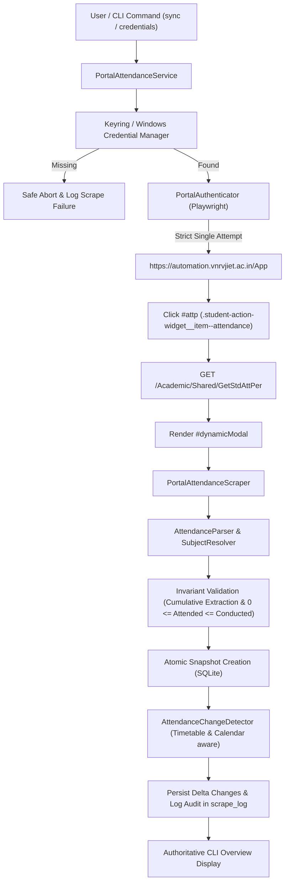

# Phase 9 — Real VNR VJIET Portal Integration

## 1. Overview & Architecture

Phase 9 integrates live student attendance retrieval from the official college portal (`https://automation.vnrvjiet.ac.in`) into the local College Attendance Tracker.

---

## 2. Implemented Modules & Architecture

### 2.1 Credential Management (`attendance_tracker/portal/credentials.py` & `setup_credentials.py`)
- **Storage**: Windows Credential Manager via the Python `keyring` library (`service_name="attendance_tracker_portal"`, `username="24071A6947"`).
- **Security Rule**: Zero credentials in plaintext configs, git repository, logs, SQLite, or error outputs.
- **Interactive CLI Setup**: `python -m attendance_tracker.cli credentials setup` prompts for credentials using standard masked `getpass`.

### 2.2 Portal Authentication (`attendance_tracker/portal/auth.py`)
- **Single-Attempt Rule (CRITICAL)**: Executes strictly **ONE** login attempt per session.
- **Zero Brute-Force / Lockout Protection**: No automated retry loops. If authentication fails, CAPTCHA is presented, or the account is locked, the process aborts immediately with `PortalAuthError`.
- **Session Indicators**: Verifies post-login workspace redirection (`/App`) and JSON response `Status == 1`.

### 2.3 Verified Portal Navigation & Modal Extraction (`attendance_tracker/portal/attendance.py`)
- **Verified DOM Sequence**:
  1. On `/App` SPA dashboard, wait for `#attp` (`.student-action-widget__item--attendance`).
  2. Click `#attp` to trigger the portal's modal AJAX request (`/Academic/Shared/GetStdAttPer`).
  3. Wait for `#dynamicModal` to open and `#dynamicModal table tr` to populate.
  4. Extract and parse `#dynamicModal table`.
- **Cumulative Attendance Extraction**:
  - Extracts the **Cumulative** column ratio (`<attended> / <conducted>`) rather than the monthly slice.
  - Formats: Handles whitespace-padded ratios (`"22 / 33"` $\rightarrow$ `attended=22, conducted=33`).
- **Subject Resolution & Validations**:
  - Resolves subject codes (`22MN6HS302`, `22OE1EN301`, etc.) to the 9 canonical VNR VJIET subjects via `SubjectResolver`.
  - Excludes the `Total` row from subject records and performs a cross-check consistency validation against total attended and conducted sum.
  - Enforces invariant: $0 \le \text{attended} \le \text{conducted}$. Fails cleanly on malformed cells or unexpected subject counts.

### 2.4 Orchestration & Sync Service (`attendance_tracker/portal/service.py`)
- High-level coordinator `PortalAttendanceService.sync_attendance()`:
  1. Checks credential availability in Windows Credential Manager.
  2. Records scrape attempt in `scrape_log`.
  3. Launches Chromium, logs in, triggers `#attp`, extracts cumulative attendance.
  4. Saves new atomic snapshot in SQLite via `repo.create_snapshot(..., source="portal")`.
  5. Computes deltas with previous snapshot and records changes in `attendance_changes`.
  6. On failure, preserves existing database snapshots without corruption and records failure in `scrape_log`.

### 2.5 CLI Integration (`attendance_tracker/cli/main.py`)
- `python -m attendance_tracker.cli sync [--headed]`
- `python -m attendance_tracker.cli credentials [check|setup|delete]`
- `python -m attendance_tracker.cli overview`
- `python -m attendance_tracker.cli ask "<query>"`
- `python -m attendance_tracker.cli chat`

---

## 3. Test Coverage & Verification

- `tests/test_portal_credentials.py`: 5 tests covering credential retrieval, isolation, missing credentials, and deletion.
- `tests/test_portal_parser.py`: 6 tests verifying verified modal DOM parsing, cumulative extraction, 9 canonical subjects mapping, total row exclusion, total consistency validation, invariant violations, and malformed strings.
- `tests/test_portal_auth.py`: 4 tests validating single-attempt success, credential error aborts, CAPTCHA challenges, and navigation timeouts.
- `tests/test_portal_service.py`: 4 tests verifying end-to-end sync, change detection persistence, safe failure with missing credentials, and database preservation on error.
- **Full Suite Status**: **550 passed, 1 skipped, 0 failed** across 30 test modules.

---

## 4. Live Portal Sync Verification Results

Live sync executed via `python -m attendance_tracker.cli sync --headed`:
- **Snapshot ID**: #2
- **Timestamp**: `2026-10-04T23:34:12+05:30`
- **Total Synced**: 9 canonical subjects, 163 / 288 (56.60%)

| Subject | Code | Attended | Conducted | Percentage | College (75%) | Target (70%) |
| :--- | :--- | :---: | :---: | :---: | :---: | :---: |
| **Gender Sensitization (GS)** | `22MN6HS302` | 4 | 12 | 33.33% | -41.7% | -36.7% |
| **Storytelling for Effective Comm. (OE-1)** | `22OE1EN301` | 12 | 26 | 46.15% | -28.8% | -23.8% |
| **Data Engineering (DE)** | `22PC1AM202` | 16 | 34 | 47.06% | -27.9% | -22.9% |
| **Automata and Compiler Design (ACD)** | `22PC1AM203` | 26 | 39 | 66.67% | -8.3% | -3.3% |
| **IoT Architecture & Protocols (IoTAP)** | `22PC1IN301` | 21 | 33 | 63.64% | -11.4% | -6.4% |
| **Operating Systems (OS)** | `22PC1IT202` | 22 | 33 | 66.67% | -8.3% | -3.3% |
| **Data Engineering Lab (DE LAB)** | `22PC2AM202` | 24 | 36 | 66.67% | -8.3% | -3.3% |
| **IoT Architecture Lab (IoTAP LAB)** | `22PC2IN301` | 15 | 33 | 45.45% | -29.5% | -24.5% |
| **Web Programming (WP)** | `22PE1AM301` | 23 | 42 | 54.76% | -20.2% | -15.2% |
| **Overall** | - | **163** | **288** | **56.60%** | Below | Below |
